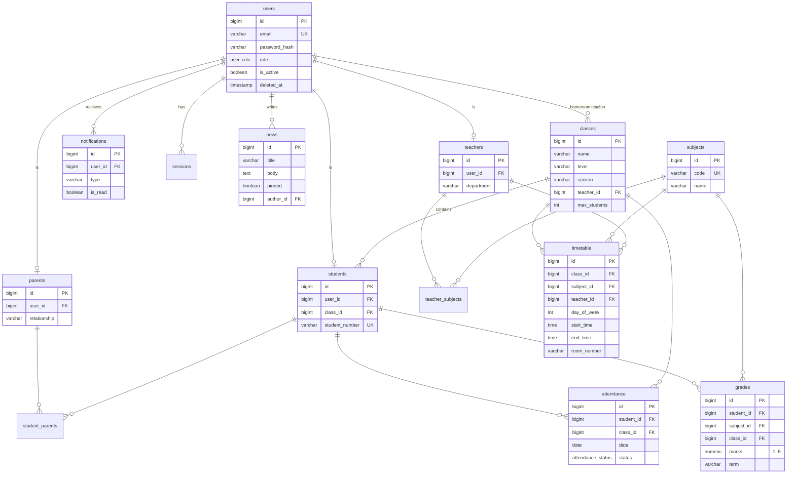

# Database design

PostgreSQL 16. Migrations are in `migrations/` (golang-migrate format, every `up` has a `down`).

## 1. ER diagram

## 2. Normalization
* **1NF.** All columns are atomic; there are no repeating groups. A student's parents and a teacher's subjects are not stored as lists in a column, they live in the link tables `student_parents` and `teacher_subjects`.
* **2NF.** Tables with a composite key (`student_parents`, `teacher_subjects`) contain only the key columns, so no attribute depends on part of the key. All other tables have a single surrogate key `id`.
* **3NF.** Non-key attributes depend only on the key. Account data (e-mail, password hash, name, role, activity flag) is stored once in `users`; `teachers`, `students` and `parents` keep only role-specific data and reference `users`. Names of classes, subjects and teachers are not copied into `grades`, `attendance` or `timetable`, they are reached through foreign keys. Overall averages and attendance percentages are not stored, they are computed (see the views), so there is no update anomaly.
* **Deliberate denormalization.** `grades.class_id` and `attendance.class_id` repeat the class the student belonged to at the time of the record. This is a historical fact (a student can change classes), not a derivable attribute, so it is kept on purpose.
* **Soft delete.** `users.deleted_at` keeps the history of marks of removed accounts.

## 3. Integrity rules
| Rule | Mechanism |
|---|---|
| E-mail, subject code, student number are unique | `UNIQUE` |
| Mark is a whole number 1-5 | `chk_grades_five_point` (migration 000003) |
| Lesson ends after it starts | `chk_timetable_time_order` |
| Day of week 0-6 | `CHECK` |
| Attendance status and user role are from a fixed list | enum types |
| A student/teacher/parent row must belong to a user | foreign key, `UNIQUE(user_id)` |

## 4. Indexes
`idx_attendance_student_date`, `idx_grades_student_term`, `idx_timetable_teacher_day`, `idx_timetable_room_day`, `idx_notifications_user_unread` serve the frequent queries (diary, reports, conflict check, bell counter) plus the indexes created by the unique constraints.

## 5. Reporting views (migration 000005)
| View | Content |
|---|---|
| `v_student_grade_summary` | per student, subject and term: `marks_count`, `average_mark` |
| `v_student_attendance_summary` | per student: `total_days`, `present_days`, `late_days`, `absent_days`, `excused_days`, `attendance_percent` = (present + late) / (total - excused) x 100, 100 when there is no data |
| `v_class_overview` | per class and student: `average_mark` and `attendance_percent` (aggregate with `GROUP BY class_id` for class totals) |

Example: `SELECT class_name, ROUND(AVG(average_mark),2) AS avg, ROUND(AVG(attendance_percent),1) AS att FROM v_class_overview GROUP BY class_name;`

## 6. Backup
See [operations.md](operations.md).
